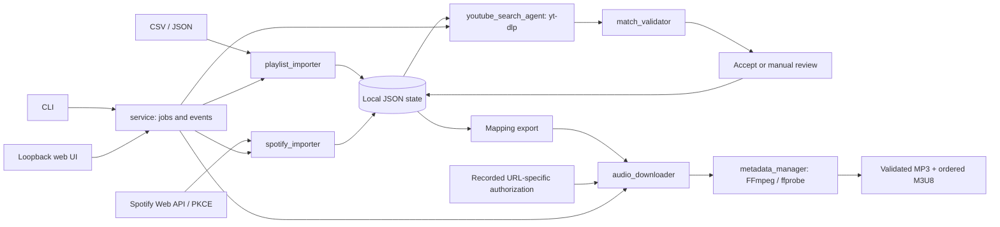

# Architecture

MusicMatcher has one shared local processing pipeline with two interfaces. Every stage uses ordinary Python and external yt-dlp/FFmpeg tools. There are no model providers or inference requests.

## Responsibilities

| Module | Responsibility |
|---|---|
| `models.py` | Pydantic song/input contracts and provenance guards. |
| `playlist_importer.py` | Entire-file CSV/JSON validation, stable identities, duplicate occurrences and explicit replacement. |
| `spotify_importer.py` | PKCE authorization, bounded loopback callback, `/items` pagination and consistent playlist snapshots. |
| `youtube_search_agent.py` | Search candidate retrieval, details, cache and resumable per-song decisions. The name is historical; this is deterministic orchestration. |
| `match_validator.py` | Pure title/artist/duration/version comparisons and documented decision reasons. |
| `mapping_manager.py` | Atomic JSON, musical identities, reusable exports and single-state locking. |
| `audio_downloader.py` | Download authorization checks, yt-dlp, staging and recovery. |
| `metadata_manager.py` | FFmpeg conversion/tagging and ffprobe-based output verification. |
| `config_manager.py` | Validated local settings, environment overrides and default paths. |
| `service.py` | One active job per instance, shared pipeline actions, progress and stop requests. |
| `cli.py` / `web.py` | CLI and loopback HTTP presentation layers. |

## Persistent state

State remains compatible with the original `schema_version=1`, `playlist` object and ordered `tracks` array. Each occurrence has a readable unique key, stable `track_id`, position, original title/artists, optional album/duration/Spotify fields, provenance, `duplicate_of`, and separate `match`, `download` and `authorization` records.

Track identity includes recording-relevant metadata; occurrence identity additionally distinguishes repeated positions. A song-to-URL dictionary is an export, not the complete source of metadata. A catalogue imported from an untrusted file does not restore audio permissions or claim that files already exist.

Imports validate before publishing. A different catalogue needs explicit replacement. Extraction reads a Spotify snapshot before and after pagination and refuses to publish if the list changed. Individual search/download results are persisted atomically. Locks serialize changes to the same state; independent catalogues use different data/output folders.

## Matching and caching

Retrieve one result and its full metadata through yt-dlp first. Stop only when the configured validator accepts it with at least 90 points, near-exact title/artist evidence, duration within 3 seconds, an official-upload hint and no uncertain version/collaborator warnings. Otherwise discover up to the configured maximum and fetch only unseen videos' details. The default maximum is 8 and the supported range is 1–25. With a maximum of 3, no more than 3 distinct videos are inspected, not 1 + 3. Retain the actual candidate count, strategy version and configured maximum in each decision. Compatible caches and duplicate occurrences reuse metadata; a changed validation profile can expand an earlier one-result decision if necessary. More candidates increase external requests; they do not guarantee a valid match. Early acceptance cannot assess ambiguity among unseen alternatives.

Comparison copies can normalize Unicode and promotional text. Stored metadata stays exact. Check credited artists, title, numbered works/parts, duration and version qualifiers. High confidence is a heuristic outcome, not a measured probability or proof of identical audio. Missing evidence and close competing candidates require review.

Cache/resume keys must include compatible original metadata and algorithm version where relevant. Preserve manual decisions. If a refreshed automatic decision changes its accepted URL or stops being accepted, invalidate stale download permission/completion state. Keep network failures distinguishable from a genuine absence of candidates. Provider-wide blocking pauses the batch instead of manufacturing unmatched songs.

## Local web and progress

The service runs a review-only second search after a successful initial search when `review_candidate_limit` (default 8) exceeds the initial maximum. It passes cached candidate metadata into an explicit expansion path, which fetches only unseen videos up to the total maximum. Only automatic `review` rows are selected, within any first-N scope. Preserve the first-pass summary separately from `review_search_summary`. A paused or blocked first pass must never trigger this phase. `review_only` and a per-request candidate maximum also expose this phase independently through the API/CLI without changing the saved first-pass settings.

The server binds to `127.0.0.1` and renders bundled static assets. Mutation requests require the instance's request token and pass host/origin checks. It is a desktop workflow, not remote multi-user hosting. The web interface sends the same actions to the service as the CLI.

Long-running work runs outside HTTP request handling. A single active job emits events for stage, completed work, total, message and timing; the browser follows progress through server-sent events. Remaining time is an estimate and can change during network operations. Cancellation is cooperative: check between songs/pages/retries and during the bounded OAuth callback. A current network/FFmpeg operation may need to return before cancellation takes effect.

## Audio boundary

An accepted match is not authorization. Check the recorded URL-specific audio permission before retrieving media. Match URLs and exported mapping URLs must agree. Artwork requires its own permitted local input; Spotify image URLs are not automatically embedded.

Use a fingerprinted staging folder, preserve recoverable partials, generate MP3 through external FFmpeg and write original metadata. Validate final audio, duration and expected tags before declaring completion or reusing a file. Preserve invalid existing files for diagnosis instead of overwriting them. The M3U8 is rebuilt from current completed outputs and retains duplicate order.

## Distribution and limits

The Python package contains application code/static assets, not FFmpeg, ffprobe, Deno, credentials, state or music. External programs and transitive Python dependencies retain their licenses. The current workflow builds source archives and wheels; native installers require a separate packaging/licensing exercise.

Spotify access requires each user's own supported developer setup, not a repository-wide Client ID. CSV/JSON keep the app useful without Spotify. No part of this architecture bypasses service access controls, and no automatic matcher can establish download rights or prove identical recordings from metadata alone.
